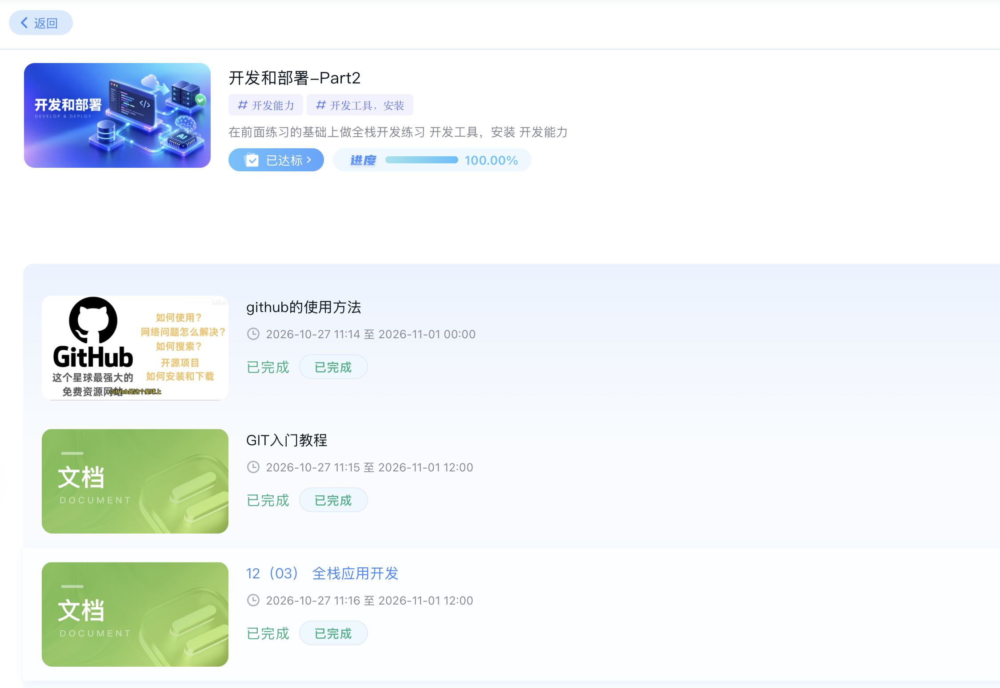
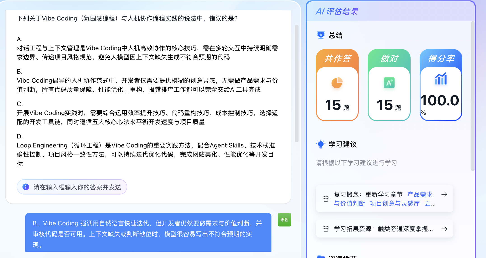
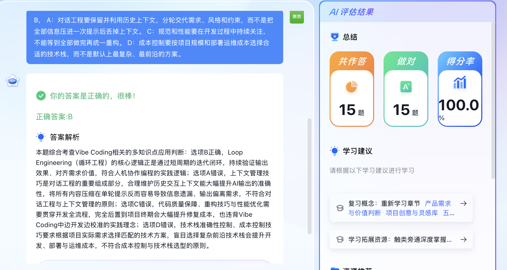
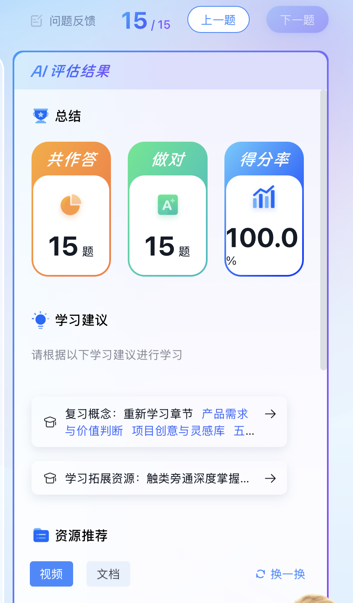
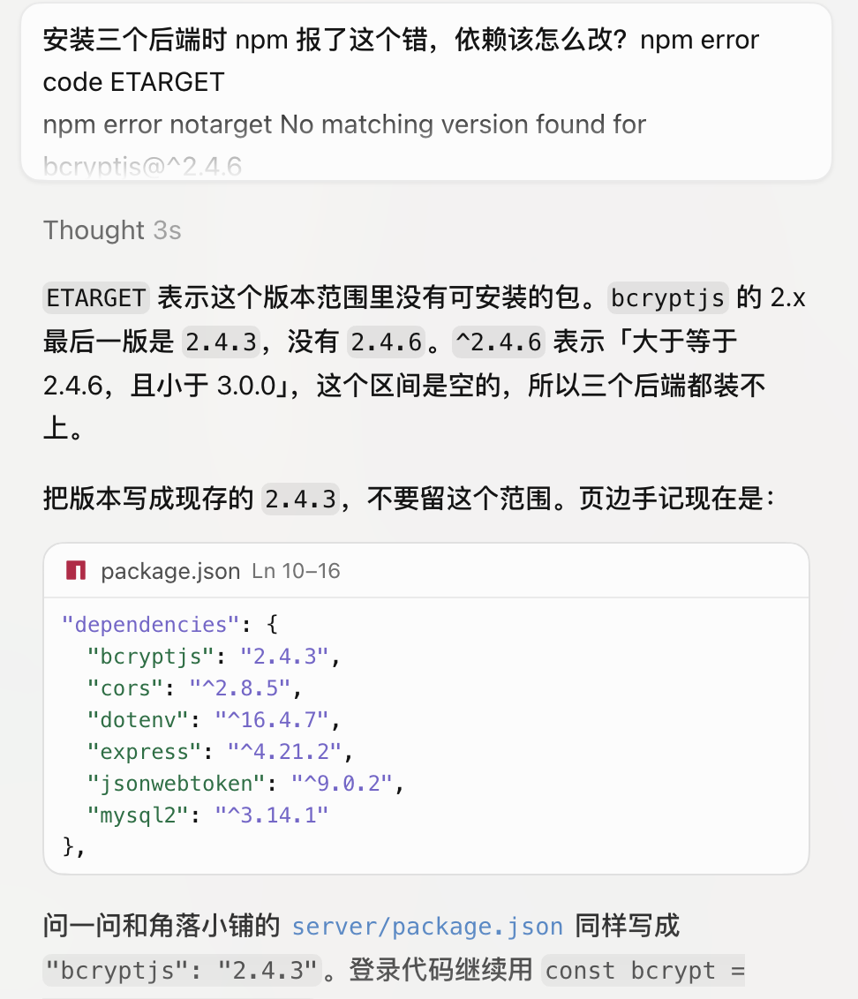
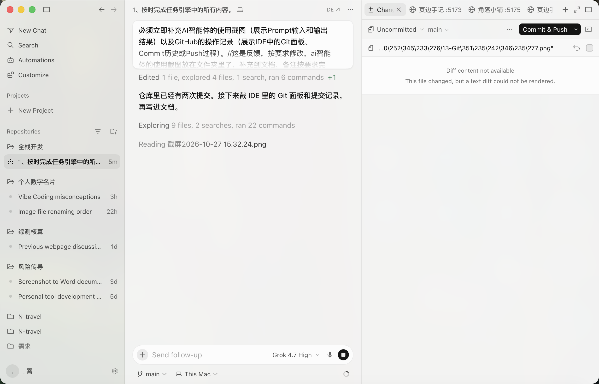
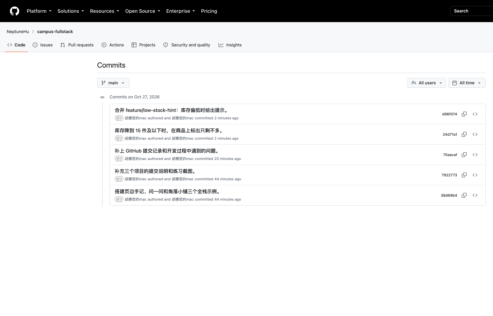

# 全栈应用开发示例项目说明

三个项目都按教程的方法做：先写数据库和需求，再用 Node.js + Express + MySQL 做接口，用 React + TypeScript + Vite 做页面，登录用 JWT。功能范围和教程一致。文中附有任务引擎的完成进度、AI 智能体练习和用它解释安装报错的记录、Cursor 里的 Git 面板，以及 GitHub 上从特性分支合并回 main 的提交记录。开发过程中实际碰到的问题也写在最后。

内容和界面换成了自己的设计。三个产品放在同一段学生生活里：用页边手记记课程和阅读，用问一问讨论做项目时卡住的问题，用角落小铺买宿舍里用得上的东西。

体验账号：`demo` / `demo123`。另一位用户是 `lin` / `lin12345`。demo 只能改自己的文章，也不能回答自己的问题。

## 页边手记

页边手记是个人博客，用来记读过、做过、想过的事。文章支持 Markdown、分类、标签和封面。首页每页 10 篇，可以按分类筛选，也可以搜标题和正文。登录后才能写。只能编辑和删除自己的文章，别人的文章没有这两个按钮。个人中心可以改邮箱和头像，并列出自己发表过的文章。

和教程示例的差别在分类和内容。分类固定为技术、生活、读书、随记，不是空的「分类一、分类二」。预置文章写的是实验笔记、辩论复盘、图书馆和食堂，版式用纸色背景和刊头，读起来像一本手记，而不是后台列表。

首页。共 12 篇，顶上是四个分类，底部可以翻到第 2 页。

文章详情。正文按 Markdown 渲染。这是 demo 自己的文章，所以有编辑和删除。lin 写的文章打开后没有这两个按钮。

写文章。左边写，右边实时预览。分类从「技术、生活、读书、随记」里选，标签用逗号分开，封面地址可以留空。

个人中心。左边改资料，右边只列出自己的文章。

## 问一问

问一问是问答社区。可以提问、回答、点赞、采纳最佳答案。列表能按最新、热门、未解决排序，也能按标签筛选。

教程里的积分，这里在页面上叫「声望」，规则写在个人中心：新用户 100；提问 -5，不够 5 不能提；回答 +10；被采纳 +30；问题被赞 +5，回答被赞 +10，取消赞会扣回。不能回答自己的问题。每个问题只能采纳一个答案，而且只有提问者可以点采纳。点赞和声望放在同一个数据库事务里，避免只改了一边。

内容和另外两个项目是连着的。预置问题不是随机题，而是做页边手记和角落小铺时会碰到的三件事：登录状态放在本地还是每次问服务器、分类要不要单独建表、购物车里同一件商品再点一次应该累加还是覆盖。标签是前端、数据库、课程。

问题列表。已解决的问题有标记。未解决筛选会把已经采纳过答案的问题拿掉。

问题详情。提问者旁边显示声望。被采纳的回答有描边和「已采纳」。未登录时点赞按钮不可用，并提示去登录。

## 角落小铺

角落小铺是 Mini 商城，卖文具、数码、零食和生活小物，例如笔记本、夹式台灯、挂耳咖啡、桌面收纳盒。可以浏览商品、加入购物车、管理收货地址、创建订单。

教程要求不接真实支付，这个限制直接写在页面上：下单后状态是「待支付」。待支付订单可以取消，取消后库存加回去。创建订单时检查库存、记下当时的价格、扣库存、清掉已下单的购物车商品，这几步在一个事务里完成，所以订单金额不会跟着以后的改价变。

收货信息按宿舍来写。示例地址是湖北省武汉市洪山区东十二舍 214，收货人周宁。demo 的购物车里放了一盏台灯，订单里有一笔待支付的笔记本和一笔已完成的饼干，方便直接看不同状态。

商品列表。分类是文具、数码、零食、生活。卡片上有价格和库存。

购物车。同一件商品再加入时数量累加，并且不能超过库存。

确认订单。勾选要结算的商品，选收货地址，应付金额按当前价格计算。提交后订单状态为待支付。

订单列表。可以按待支付、已支付、已发货、已完成、已取消筛选。

订单详情。包含下单时的单价、合计和收货地址。待支付订单可以取消。

地址。默认地址排在前面。设新的默认地址时，原来的默认会被取消。已经被订单用过的地址不能删除。

## 任务引擎

任务引擎里这一部分的进度是 100.00%，状态为已达标。页面上「github的使用方法」「GIT入门教程」「全栈应用开发」都标着已完成。

## AI 智能体

AI 智能体这项按要求完成，并获得满分。15 道题全部作答，15 道全部做对，得分率 100.0%，成绩为 A+。

练习时把题目发给智能体，再对照它的判断检查自己的答案。下面这一题问的是：关于 Vibe Coding（氛围感编程）和人机协作，哪一种说法是错的。输入框里提交的是 B，并写明开发者仍然要做需求与价值判断，还要审核代码是否可用；上下文缺失或判断缺位时，模型很容易写出不符合预期的实现。

智能体给出了判断和解析。它确认正确答案是 B，并说明 A、C、D 错在哪里。页面上显示「你的答案是正确的，很棒！」右侧评估结果同时是 15 题全部做对、得分率 100.0%。

整份练习的评估结果单独看也是满分：共作答 15 题，做对 15 题，得分率 100.0%。

做题之外，安装依赖时也把终端报错交给智能体。三个后端安装时 npm 报 `ETARGET`，找不到 `bcryptjs@^2.4.6`。智能体说明 2.x 的最后一版是 2.4.3，这个范围内没有 2.4.6，并把三个 `server/package.json` 里的依赖改成现存版本。

## 版本管理

三个项目放在本地仓库「全栈开发」里，用 Cursor 自带的 Git 做版本管理，再推到 GitHub。当前分支是 main。远程仓库是公开的，评阅时可以直接打开：

https://github.com/NeptuneHu/campus-fullstack

库存提示没有直接写在 main 上。先从 main 拉出特性分支 `feature/low-stock-hint`，在这条分支上提交改动，再用非快进合并回到 main。因此历史里同时有特性分支上的那一次提交，和合并提交。

- `d96f074` 合并 feature/low-stock-hint：库存偏低时给出提示。
- `24d71a1` 库存降到 15 件及以下时，在商品上标出只剩不多。
- `70aacaf` 补上 GitHub 提交记录和开发过程中遇到的问题。
- `7922773` 补充三个项目的提交说明和练习截图。
- `38d69b4` 搭建页边手记、问一问和角落小铺三个全栈示例。

角落小铺的商品列表里，库存降到 15 件及以下会多出「只剩不多」。夹式小台灯库存是 15，能看到这句；库存更高的商品没有。

IDE 里的 Git 面板能看到当前分支 main，以及 Commit & Push。

GitHub 网页上，main 的提交记录最上面是合并 `feature/low-stock-hint`，紧接着是这条特性分支上的提交。作者显示为胡惠哲的mac，日期是 2026 年 10 月 27 日。

## 开发过程中碰到的问题

搭环境时先卡住的是 Docker。项目文件夹叫「全栈开发」，`docker compose` 会把中文目录名滤成空的项目名，报 project name must not be empty。在 `docker-compose.yml` 开头写上 `name: fullstack` 之后，项目名才固定下来。接着拉取 `mysql:8.0` 超时，改从镜像站下载 `docker.m.daocloud.io/library/mysql:8.0`，打上 `mysql:8.0` 标签后再启动，MySQL 容器才变为健康。

安装依赖时三个后端都写成了 `bcryptjs@^2.4.6`，npm 报 ETARGET。这个报错交给智能体看过，它指出 2.x 的最后一版是 2.4.3，没有 2.4.6。三个 `server/package.json` 都改成固定的 `2.4.3`，安装才通过。登录密码仍然用 bcrypt 做哈希。

页边手记的阅读数会自己加两次。开发模式下页面会挂载两遍，详情接口每次打开都给阅读数加一，所以数字跳得比实际快。`blog/web/src/main.tsx` 里去掉了这层双重挂载。作者自己看文章时请求带 `preview=1`，详情接口确认是作者本人就不加阅读数。

问一问的个人中心打开后会不停请求 `/users/me`。`updateUser` 放在会随用户信息一起重建的 context 里，如果页面效果依赖它，每次把资料写回去都会再请求一次。个人中心只在进入页面时拉一次资料，效果的依赖留空，循环就停了。
