# 全栈应用开发示例项目说明

三个项目都按教程的方法做：先写数据库和需求，再用 Node.js + Express + MySQL 做接口，用 React + TypeScript + Vite 做页面，登录用 JWT。功能范围和教程一致。

内容和界面换成了自己的设计。三个产品放在同一段学生生活里：用页边手记记课程和阅读，用问一问讨论做项目时卡住的问题，用角落小铺买宿舍里用得上的东西。

体验账号：`demo` / `demo123`。另一位用户是 `lin` / `lin12345`。demo 只能改自己的文章，也不能回答自己的问题。

## 页边手记

页边手记是个人博客，用来记读过、做过、想过的事。文章支持 Markdown、分类、标签和封面。首页每页 10 篇，可以按分类筛选，也可以搜标题和正文。登录后才能写。只能编辑和删除自己的文章，别人的文章没有这两个按钮。个人中心可以改邮箱和头像，并列出自己发表过的文章。

和教程示例的差别在分类和内容。分类固定为技术、生活、读书、随记，不是空的「分类一、分类二」。预置文章写的是实验笔记、辩论复盘、图书馆和食堂，版式用纸色背景和刊头，读起来像一本手记，而不是后台列表。

首页。共 12 篇，顶上是四个分类，底部可以翻到第 2 页。

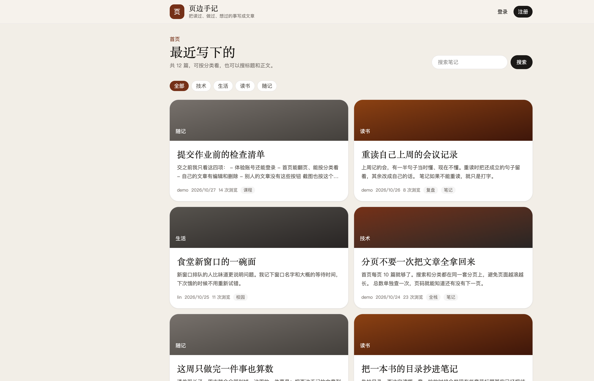

文章详情。正文按 Markdown 渲染。这是 demo 自己的文章，所以有编辑和删除。lin 写的文章打开后没有这两个按钮。

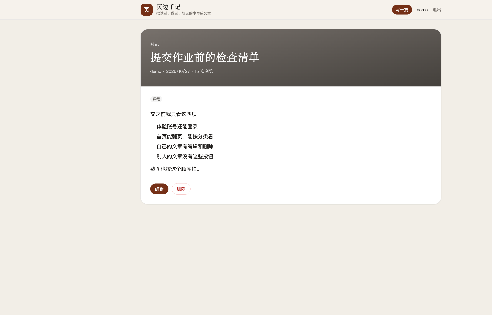

写文章。左边写，右边实时预览。分类从「技术、生活、读书、随记」里选，标签用逗号分开，封面地址可以留空。

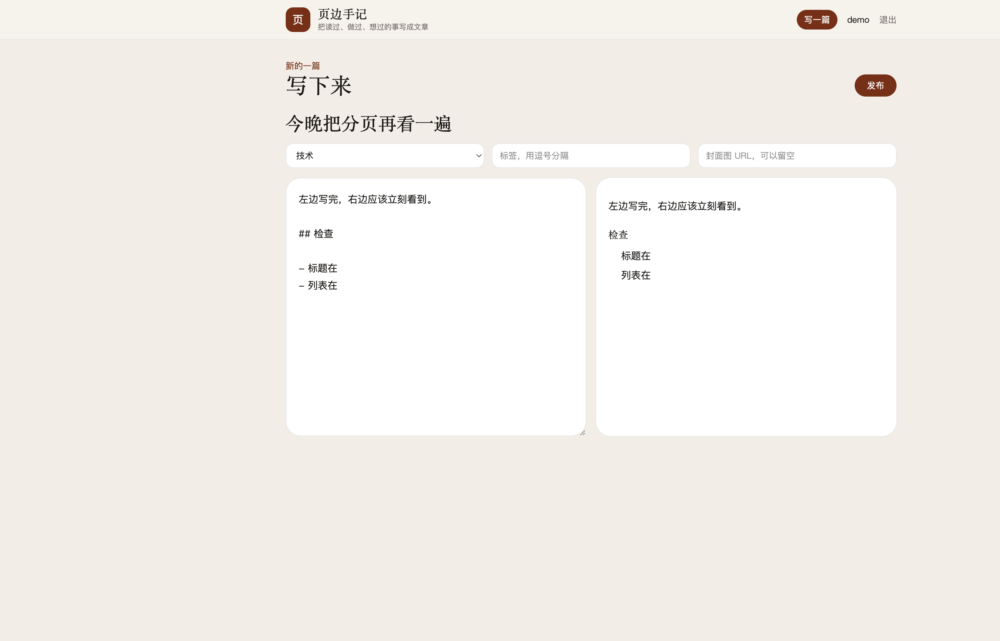

个人中心。左边改资料，右边只列出自己的文章。

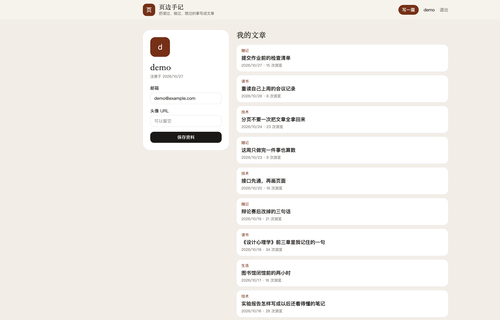

## 问一问

问一问是问答社区。可以提问、回答、点赞、采纳最佳答案。列表能按最新、热门、未解决排序，也能按标签筛选。

教程里的积分，这里在页面上叫「声望」，规则写在个人中心：新用户 100；提问 -5，不够 5 不能提；回答 +10；被采纳 +30；问题被赞 +5，回答被赞 +10，取消赞会扣回。不能回答自己的问题。每个问题只能采纳一个答案，而且只有提问者可以点采纳。点赞和声望放在同一个数据库事务里，避免只改了一边。

内容和另外两个项目是连着的。预置问题不是随机题，而是做页边手记和角落小铺时会碰到的三件事：登录状态放在本地还是每次问服务器、分类要不要单独建表、购物车里同一件商品再点一次应该累加还是覆盖。标签是前端、数据库、课程。

问题列表。已解决的问题有标记。未解决筛选会把已经采纳过答案的问题拿掉。

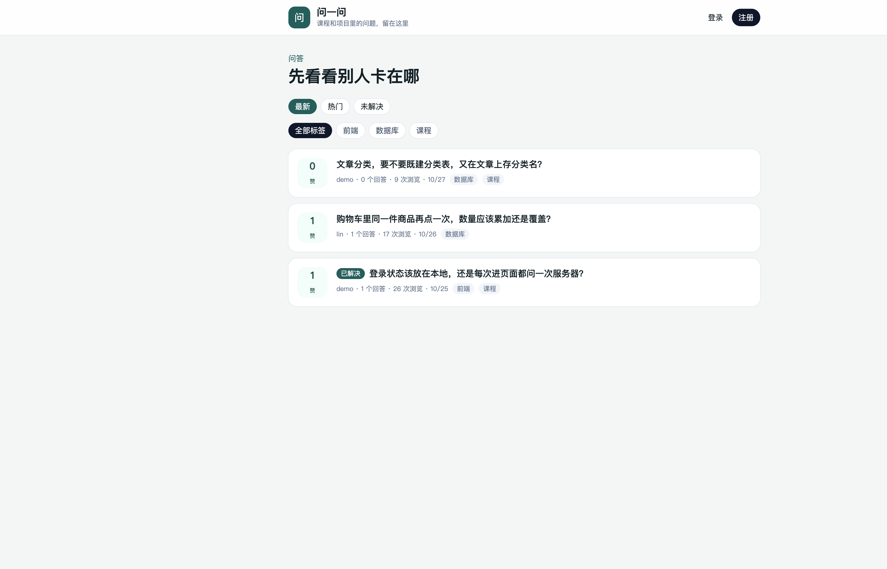

问题详情。提问者旁边显示声望。被采纳的回答有描边和「已采纳」。未登录时点赞按钮不可用，并提示去登录。

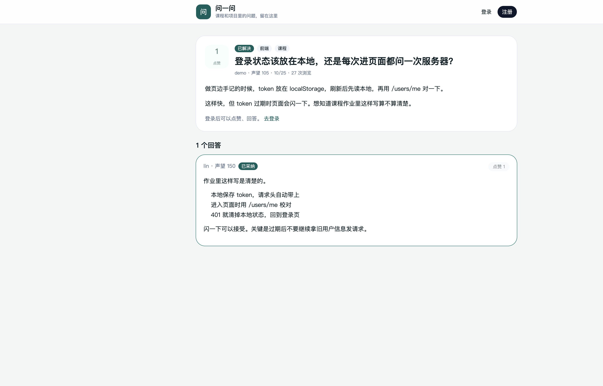

## 角落小铺

角落小铺是 Mini 商城，卖文具、数码、零食和生活小物，例如笔记本、夹式台灯、挂耳咖啡、桌面收纳盒。可以浏览商品、加入购物车、管理收货地址、创建订单。

教程要求不接真实支付，这个限制直接写在页面上：下单后状态是「待支付」。待支付订单可以取消，取消后库存加回去。创建订单时检查库存、记下当时的价格、扣库存、清掉已下单的购物车商品，这几步在一个事务里完成，所以订单金额不会跟着以后的改价变。

收货信息按宿舍来写。示例地址是湖北省武汉市洪山区东十二舍 214，收货人周宁。demo 的购物车里放了一盏台灯，订单里有一笔待支付的笔记本和一笔已完成的饼干，方便直接看不同状态。

商品列表。分类是文具、数码、零食、生活。卡片上有价格和库存。

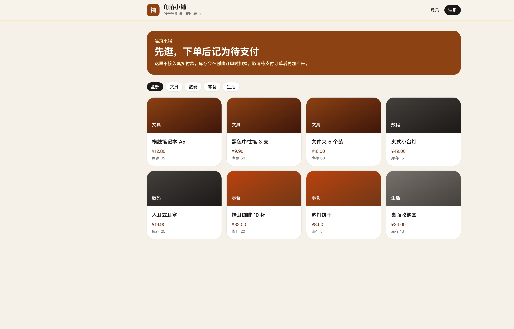

购物车。同一件商品再加入时数量累加，并且不能超过库存。

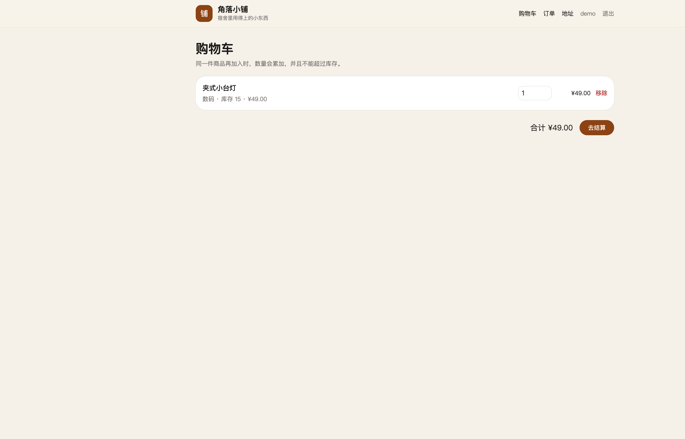

确认订单。勾选要结算的商品，选收货地址，应付金额按当前价格计算。提交后订单状态为待支付。

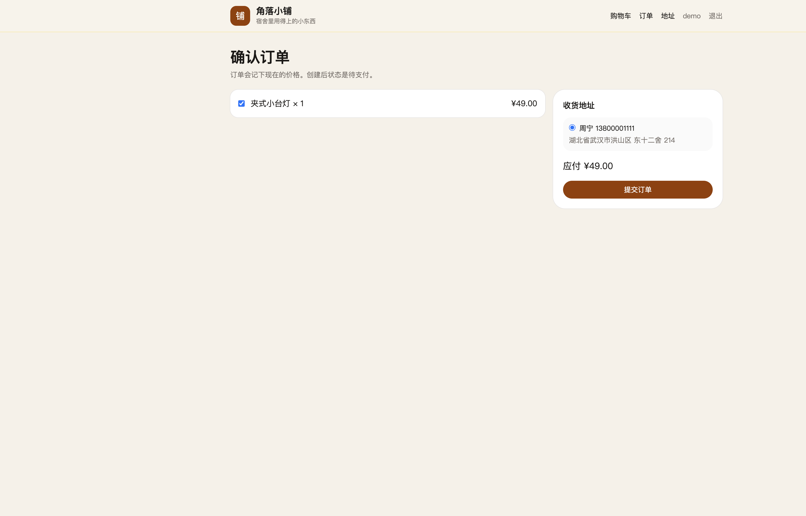

订单列表。可以按待支付、已支付、已发货、已完成、已取消筛选。

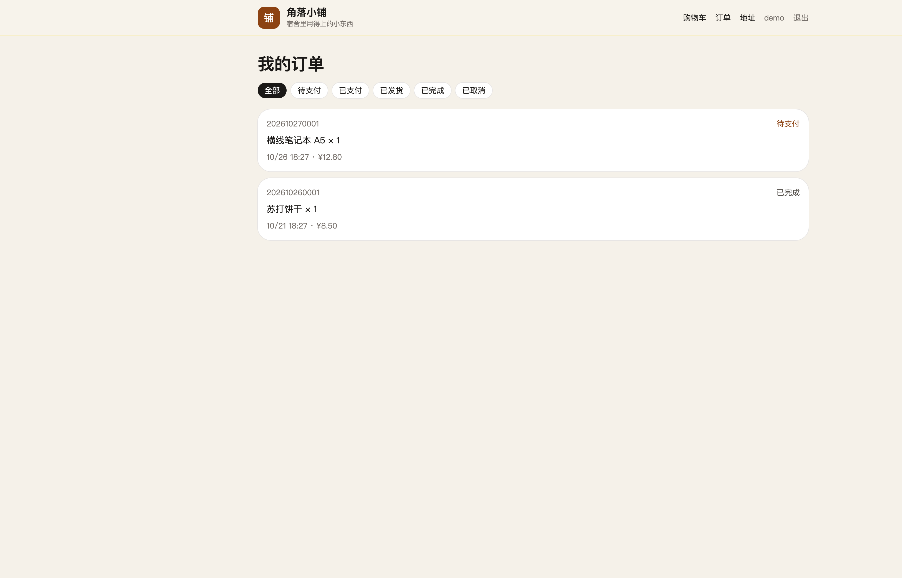

订单详情。包含下单时的单价、合计和收货地址。待支付订单可以取消。

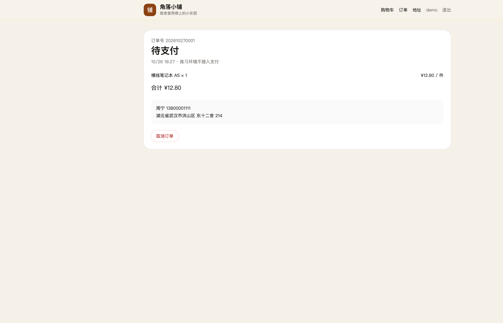

地址。默认地址排在前面。设新的默认地址时，原来的默认会被取消。已经被订单用过的地址不能删除。

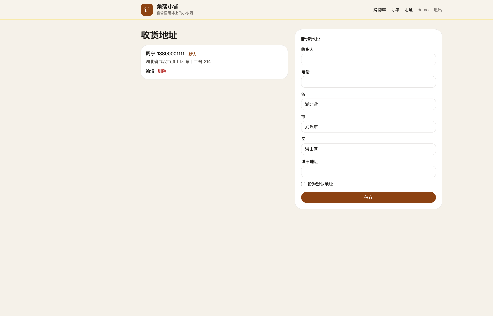
